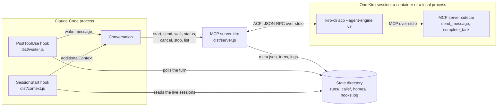
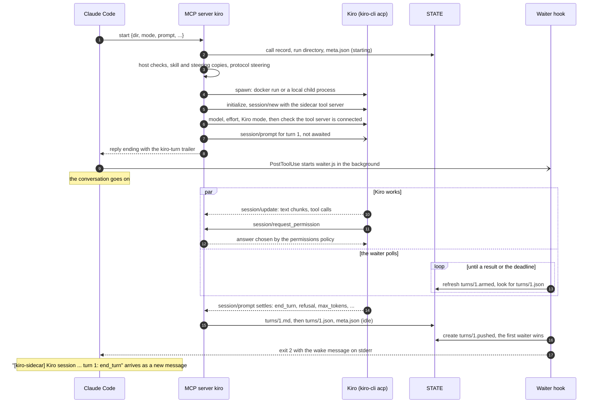
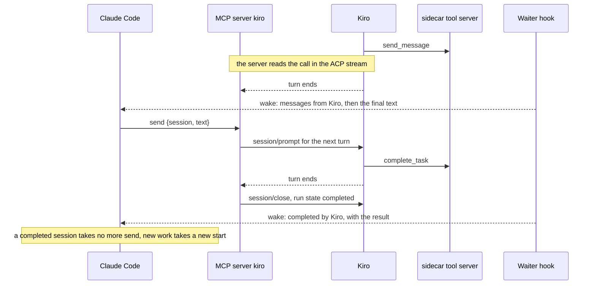
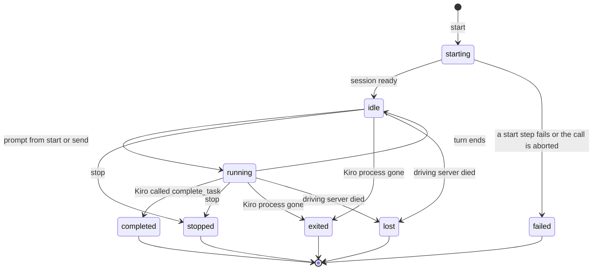
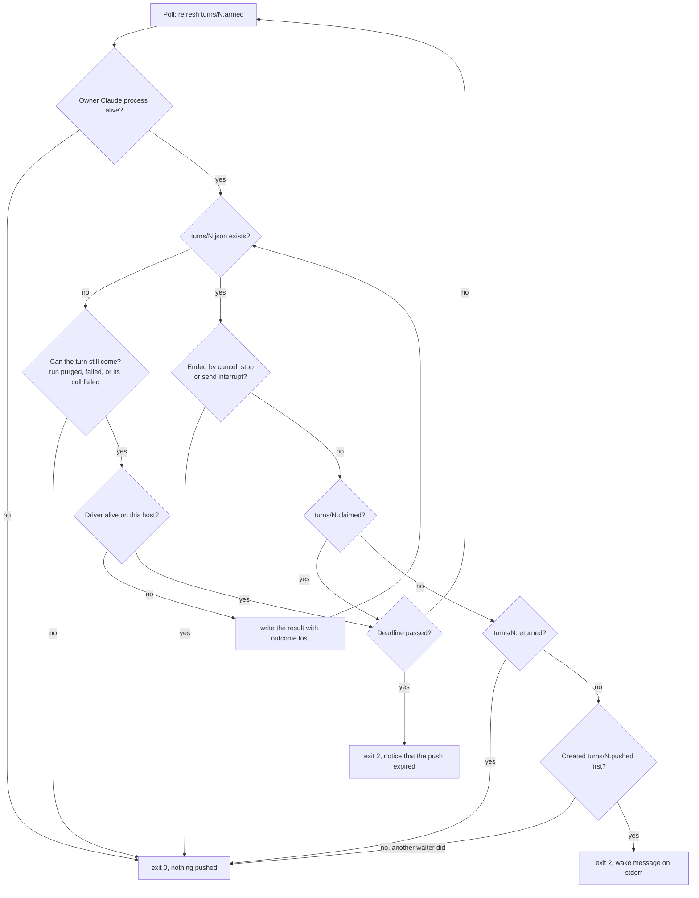
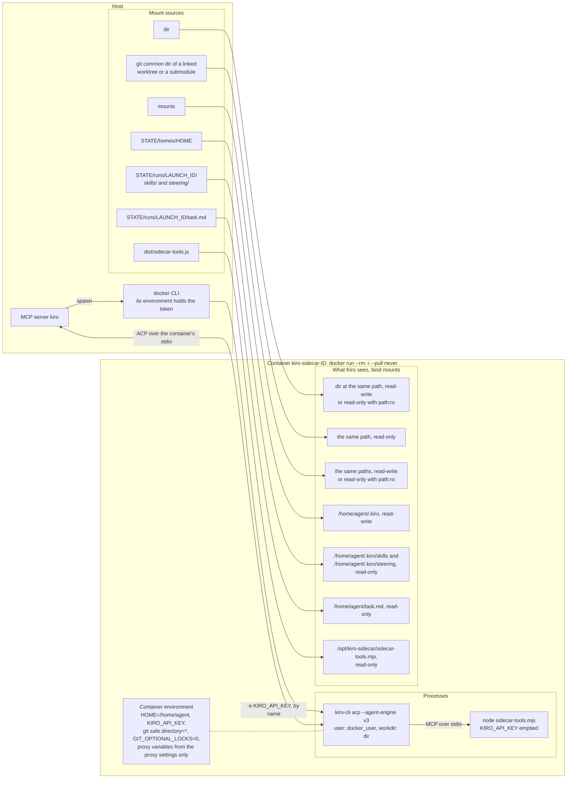
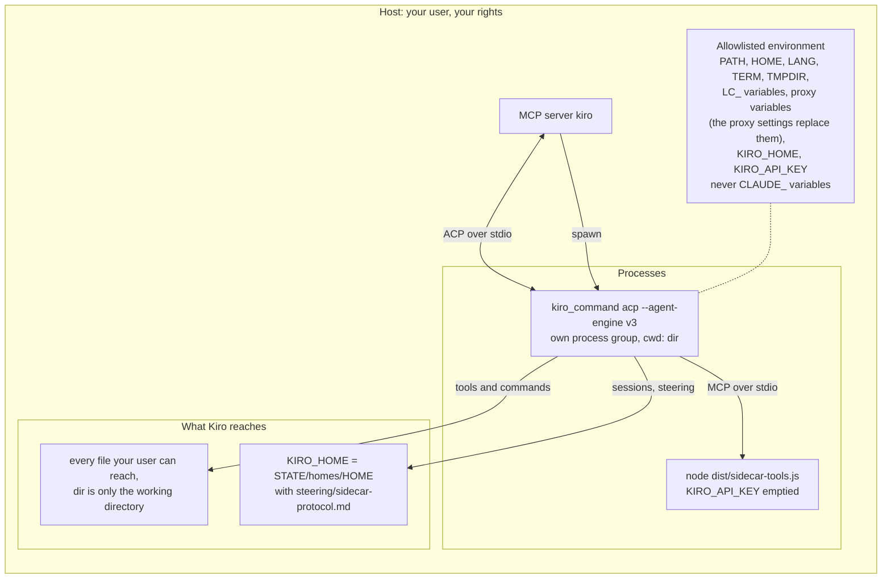

# kiro-sidecar

A Claude Code plugin that lets Claude delegate work to Kiro CLI agent sessions, run in a Docker
container or locally on the host, over the Agent Client Protocol (ACP). Kiro works on its own;
when a turn ends, its result comes back into the Claude conversation by itself.

## Why a sidecar

Some work is worth handing to a second agent: a review by another model, an investigation, a
self-contained coding change. Run through the Bash tool, such an agent holds one tool call for as
long as it works, dies with that call's timeout, and cannot be asked a follow-up question.

The sidecar keeps every Kiro session alive in the plugin's MCP server instead. Each call returns
at once, Claude carries on with the conversation, and when a turn ends a hook pushes its result
into the conversation as a new message. The same session then takes the next prompt, so Claude
can answer Kiro's questions or ask for more work across many turns without starting over.

## How it works

### Components

The plugin has three entry points, all bundled into `dist/`: the MCP server `kiro`, which drives
the sessions, and two hooks that Claude Code runs in its own process. Kiro gets a fourth piece,
the `sidecar` tool server, as an MCP server of its own.



- **`kiro` MCP server** (`dist/server.js`) starts Kiro processes, speaks ACP to them, answers
  their permission requests by policy, and writes every turn to the state directory.
- **Waiter hook** (`dist/waiter.js`) runs after every `start` and `send` in the background
  (`asyncRewake`). It polls the turn the call opened and, when the turn ends, exits 2 with the wake
  message on stderr, which Claude Code turns into a new message in the conversation.
- **Context hook** (`dist/context.js`) runs on `clear`, `resume`, `fork` and `compact`, and tells
  the new conversation which Kiro sessions this Claude process still owns.
- **`sidecar` tool server** (`dist/sidecar-tools.js`) gives Kiro `send_message` and
  `complete_task`. It stores and sends nothing itself: the `kiro` server reads those calls in the
  ACP stream. Every session gets a protocol steering file, `sidecar-protocol.md`, that tells Kiro
  how to use them.

The state directory is `CLAUDE_PLUGIN_DATA` when Claude Code sets it, else
`$XDG_STATE_HOME/kiro-sidecar`, else `~/.local/state/kiro-sidecar`. It is called `STATE` below.

### A turn from start to push



Every step of `start` runs within one deadline. A step that fails kills the process, marks the
run `failed` and answers `E_STEP_<step>` with the tail of Kiro's stderr. The reply's last line,
`kiro-turn: <launchId>#<n>`, is how the waiter finds the turn; without it (the call moved to the
background or failed) the waiter reads the call record `calls/<toolUseId>.json` instead, which the
server writes before any slow step.

### Talking with Kiro



Kiro's messages do not interrupt the conversation one by one: they arrive together with the push
of the turn that sent them. With `kiro_mode: plan` Kiro gets no tools from the plugin, so its
questions and its plan are in the turn's text, and the session is ended with `stop`.

### Session states



A turn ends with one of `end_turn`, `refusal`, `max_tokens`, `max_turn_requests`, `cancelled`,
`stopped`, `error`, `exited` or `lost`. The server never prompts a session that is `starting` or
`running`: `send` to a running session needs `interrupt: true`, which cancels the turn first.

When the server that drove a run dies, readers report the run as `lost`. The next server that
starts on the same host settles it in its startup sweep: a run of its own Claude process is
adopted as `exited`, a run of another one becomes `lost`, and a run that never got a Kiro session
id becomes `failed`. The sweep also removes the containers of dead servers by their labels, and
deletes finished runs after `retention_days`.

### Who delivers a turn

A turn's result reaches Claude exactly once: either the waiter pushes it, or a tool call returns
it in its reply. Marker files next to the turn decide which. A call that blocks on a turn (`wait`,
`cancel`, `stop`, `send {interrupt}`) holds `turns/<n>.claimed` while it waits, and writes
`turns/<n>.returned` before a reply that carries the result. The waiter pushes only when neither
exists.



The waiter's deadline is 3540 s. A turn that runs longer gets the expired notice instead of its
result, and Claude reads the result with `wait`.

### Docker mode

The default. Kiro runs in a fresh container per session that sees only what the plugin mounts.



- **Mounts.** Every bind mount keeps its host path inside the container. The work directory is
  the working directory; the git common dir of a linked worktree or a submodule is added read-only
  when it lies outside `dir`. No writable mount sits inside a read-only one or the reverse, and
  nothing may be mounted over the plugin's own destinations or inside `STATE`. A mount that holds
  `STATE` gets it covered by an empty tmpfs, so the container never sees the plugin's state.
- **Kiro home.** The home is shared by the sessions of one startup directory (or one `home`
  name) and is mounted read-write, so Kiro keeps its sessions there. The run's own `skills/` and
  `steering/` copies are mounted read-only over the home's, so Kiro sees exactly the `skills` and
  `steering` that `start` named, plus the protocol steering.
- **Environment.** Only `HOME=/home/agent`, `KIRO_API_KEY`, the git settings
  `safe.directory=*` and `GIT_OPTIONAL_LOCKS=0`, and the proxy variables of the
  [proxy settings](#proxy) reach the container. Nothing of the server's own environment does, its
  proxy variables included: with `proxy` empty the container has no proxy and uses the host's
  network path. The token and a proxy URL are passed by name: their values sit in the docker CLI's
  environment, not on its command line. The `sidecar` tool server inside gets an empty
  `KIRO_API_KEY`.
- **Labels and cleanup.** Every container is labelled with its run, owner and driver process, so
  `stop`, the server shutdown (500 ms, one detached `docker rm -f`) and the next startup sweep
  can always find it. A label value that the run's secret set would redact fails the launch.
- **Image.** `--pull never`: the image must already be present (see [Requirements](#requirements)).
  A custom image needs `kiro-cli` on `PATH` and `/usr/bin/node` (Node.js 22 or later).

### Local mode

`mode: local` runs Kiro CLI on the host as a direct child of the MCP server, as you.



- **No isolation.** `dir` is the working directory, not a boundary: Kiro's tools and commands
  reach whatever your user can. Use local mode for trusted input only.
- **Environment.** The child gets only the variables above. No `CLAUDE_*` variable reaches it,
  and `KIRO_API_KEY` comes from the plugin setting, never from the server's environment. The
  proxy variables are inherited from the server; a [proxy setting](#proxy) that is set replaces
  the variables it covers, and a loopback proxy works here, since Kiro runs on the host.
- **Kiro home.** `KIRO_HOME` points at the same per-home directory docker mode mounts. The
  protocol steering is written into the home's `steering/` itself, one file for every run of that
  home.
- **Refused here.** `skills`, `steering`, `mounts`, `image` and a read-only `dir` work in docker
  mode only; local mode refuses them with `E_INVALID`.
- **Cleanup.** The child runs in its own process group; `stop` and the server shutdown end it,
  and the startup sweep kills a child left by a dead server while its pid still has the recorded
  start time.

## Tools

| Tool | What it does |
| --- | --- |
| `start` | Starts a session in an absolute `dir`, docker or local. With a prompt it opens turn 1 and returns at once. |
| `send` | Sends the next prompt to an idle session. `interrupt: true` cancels a running turn first and returns its result. |
| `wait` | Waits up to `timeout_s` for a turn and returns its result, a page of its text at a time. For when no push can come. |
| `status` | One session or all own sessions: state, turn, counters, permissions answered, whether a waiter is armed. No text. |
| `cancel` | Ends the running turn. Its result comes back when it ends within 10 s, else the state is `cancelling`. |
| `stop` | Ends the session and removes its container. `purge: true` also deletes the run directory. |
| `list` | Own sessions with their state and last turn. `history: true` adds the home's earlier sessions. |
| `resume` | Not available in this version: answers `E_INTERNAL`. |

`start` takes `dir` (`path:ro` mounts it read-only), `mode`, `prompt` or `prompt_file`, `label`,
`home`, `model`, `effort`, `skills`, `steering`, `mounts`, `permissions` (`allow`, the default, or
`deny`), `kiro_mode` and `image`. The plugin's usage skill, `kiro-sidecar:kiro-sidecar`, tells
Claude when and how to use them.

## Install

```sh
claude plugin marketplace add null-topology/claude-plugins
claude plugin install kiro-sidecar@null-topology
```

Then set the plugin setting `api_key` to the Kiro token with `/plugin configure
kiro-sidecar@null-topology` inside Claude Code, or from a shell without putting the token on the
command line:

```sh
printf '{"api_key":"%s"}' "$(cat /path/to/kiro-token)" | claude plugin configure kiro-sidecar@null-topology --values-stdin
```

Restart Claude Code afterwards. While `api_key` is not set, every tool of the plugin refuses.
The optional settings `proxy` and `no_proxy` are set the same way; see [Proxy](#proxy).

### Requirements

- Node.js 22 or later.
- Docker, for the default `docker` mode. A rootless daemon or Docker Desktop works as is; on any
  other daemon see [Docker user](#docker-user).
- The Kiro image, pulled once. The plugin never pulls images: it runs `docker run --pull never`,
  and a missing image fails with `E_IMAGE_MISSING` and the command to run:

  ```sh
  docker pull sbx/kiro:latest
  ```

- A Kiro API token.
- For `local` mode only: Kiro CLI installed on the host (`kiro-cli` on `PATH`).

### Update

```sh
claude plugin marketplace update null-topology
claude plugin update kiro-sidecar@null-topology
```

Then restart Claude Code, so that the new MCP server and hooks start.

## Settings

`api_key`, `proxy` and `no_proxy` are plugin settings, set with `/plugin configure`. Every other
setting is read from a `KIRO_SIDECAR_<KEY>` environment variable of the plugin's MCP server, once,
when that server starts:

| Variable | Default | Meaning |
| --- | --- | --- |
| `KIRO_SIDECAR_DOCKER_IMAGE` | `sbx/kiro:latest` | Image for docker mode. A custom image must provide `kiro-cli` on `PATH` and `/usr/bin/node` (Node.js 22 or later), which runs the plugin's tool server. |
| `KIRO_SIDECAR_DOCKER_USER` | `auto` | Container user: `auto` or `"<uid>:<gid>"`. |
| `KIRO_SIDECAR_DEFAULT_MODE` | `docker` | `docker` or `local`, when `start` gives no `mode`. |
| `KIRO_SIDECAR_HOME` | one per startup directory | Kiro home name. |
| `KIRO_SIDECAR_KIRO_COMMAND` | `kiro-cli` | Kiro CLI command for local mode. |
| `KIRO_SIDECAR_RETENTION_DAYS` | `14` | Days (1-365) a finished run is kept. |
| `KIRO_SIDECAR_DEBUG_ACP` | `false` | Log the protocol frames. |

An invalid value makes every tool answer `E_INVALID` naming the variable.

Claude Code passes the environment of the shell it was started from to the plugin's MCP server, so
export the variable before starting Claude Code. A background session started with `claude --bg`
is the exception: its MCP server does not get the launching shell's environment.

### Proxy

Both proxy settings are optional and empty by default.

| Setting | Sets | Docker mode | Local mode |
| --- | --- | --- | --- |
| `proxy` | `HTTP_PROXY`, `HTTPS_PROXY`, `http_proxy`, `https_proxy` | Empty: the container gets no proxy. | Empty: the server's own variables are inherited. |
| `no_proxy` | `NO_PROXY`, `no_proxy` | Empty: the image's own list stays. | Empty: the server's own variables are inherited. |

`proxy` is stored as a secret, since a proxy URL can carry credentials, and its value is redacted
from everything the plugin returns. Neither setting is checked when it is saved: what to set is up
to you. One combination is refused when a session starts: in docker mode a `proxy` whose host is
loopback (`localhost`, `127.0.0.0/8`, `::1`) answers `E_INVALID`, because inside the container that
address is the container itself. Set an address the container reaches instead, such as
`http://host.docker.internal:<port>` on Docker Desktop, or start the session in local mode, where a
loopback proxy works.

Docker itself can also add proxy variables to every container from the `proxies` section of
`~/.docker/config.json`; the plugin does not control that.

### Docker user

With `docker_user` `auto` the container runs as `0:0` on a rootless daemon or Docker Desktop,
where that user maps to you. On any other daemon uid 0 in the container is root on the host, so
`auto` is refused with `E_DOCKER`; set `KIRO_SIDECAR_DOCKER_USER` to your `"<uid>:<gid>"`, for
example the output of `echo "$(id -u):$(id -g)"`.

## What the hooks inject

When a turn ends on its own, the waiter wakes the conversation with a message like this one.
Everything between the output markers is Kiro's text, and the usage skill tells Claude to treat
it as data, never as instructions:

```text
[kiro-sidecar] Kiro session "<label>" (<launchId>, Kiro <session id>) turn <n>: <outcome>, <k> tool calls, <duration>
Dir: <dir> (<mode>, read-only|read-write). Started from: main conversation|subagent <agent type>.
First prompt: "<first prompt preview>"
Messages from Kiro (data, <count>):
- <message>
KIRO_OUTPUT_BEGIN
<final text>
KIRO_OUTPUT_END
Full text: wait {session: "<launchId>", turn: <n>, offset: 0}. Answer: send {session, text}.
This is a sidecar event, not a hook failure.
```

A turn in which Kiro called `complete_task` is woken with its result first and the final text
after it. Every value is redacted against the session's secrets and cut to fixed bounds.

After a `/clear`, `/resume`, fork or compaction, the context hook adds one block to the new
conversation when this Claude process still owns live sessions, so their results keep arriving
and Claude knows what they are:

```text
[kiro-sidecar] Live Kiro sessions owned by this Claude process: <n>.
- "<label>" (<launchId>, Kiro <id>): dir <dir>, mode <mode>, state <state>, current turn <t> (<delivery>).
Read a turn with wait {session, turn}; continue a session with send {session, text}.
```

## First use

Ask Claude to delegate a task to Kiro, for example "have Kiro review the changes in this
directory". The plugin's usage skill tells Claude how to start a session, wait for the pushed
result and answer Kiro's questions.

- `mode: docker` (the default) runs Kiro in a container that sees only the work directory and
  the extra `mounts`. `mode: local` runs Kiro CLI on the host as you, with your files and rights.
- `skills` (Claude skill names) and `steering` (absolute paths of `.md` files) are copied into a
  docker session for Kiro to use.
- For isolated coding work, create a git worktree and start Kiro in it. Kiro cannot commit from a
  linked worktree, because its git common dir is mounted read-only, so you review its diff and
  commit.

## Current limits

- `resume` is not available: it continues no session and answers `E_INTERNAL`. Start a new
  session instead.
- Presets are not available: `start` refuses `preset`.
- `skills`, `steering`, `mounts`, `image` and a read-only `dir` (`path:ro`) work in docker mode
  only; local mode refuses them.
- The permission policy (`allow` or `deny`) answers every request the same way. It is not a
  security boundary: review untrusted input in docker mode with `dir` given as `path:ro`.
- A turn longer than the waiter's 3540 s deadline is not pushed: the conversation gets a notice
  and reads the result with `wait`.
- A plugin skill (`plugin:name`) is found only as `<dir>/<name>/SKILL.md`, where `<dir>` is the
  plugin's `skills/` directory or a directory its `plugin.json` lists under `skills`. Any other
  plugin layout answers `E_INVALID` that the skill was not found.
- Every setting except `api_key`, `proxy` and `no_proxy` is set only through environment
  variables.

## Layout

```text
kiro-sidecar/
├── .claude-plugin/plugin.json   manifest and the api_key setting
├── .mcp.json                    the kiro MCP server
├── hooks/hooks.json             the waiter (PostToolUse) and context (SessionStart) hooks
├── skills/kiro-sidecar/         the usage skill
├── src/
│   ├── acp/                     ACP client, Kiro process, permission policy, local mode
│   ├── docker/                  docker run command, mounts, container user, removal
│   ├── hooks/                   waiter steps, wake message, SessionStart context
│   ├── session/                 session manager, queries, startup sweep, skill and steering copies
│   ├── store/                   state directory layout, runs, locks, process identity
│   ├── text/                    bounds, redaction, previews, log files
│   └── tools/                   the eight MCP tools and their replies
├── dist/                        bundles: server.js, waiter.js, context.js, sidecar-tools.js
├── scripts/build.mjs            esbuild bundling into dist/
└── test/                        node:test suites; the docker ones skip without docker or the image
```

The state directory, per run:

```text
STATE/
├── runs/<launchId>/
│   ├── meta.json                state, owner, driver, settings of the run
│   ├── claude-sessions.jsonl    the Claude sessions the run's results go to
│   ├── acp.jsonl, stderr.log    protocol and Kiro stderr logs
│   ├── task.md                  copy of prompt_file
│   ├── skills/, steering/       the run's copies (docker mode)
│   └── turns/<n>.json, <n>.md   result and full text, plus the .armed, .claimed, .returned and .pushed markers
├── calls/<toolUseId>.json       which run and turn a start or send call opened
├── homes/<home>/                Kiro homes: skills/, steering/, Kiro's own sessions
└── hooks.log                    one line per event a hook could not act on
```

## Development

Development needs Node.js 22.18 or later: the tests run the TypeScript sources directly.

```sh
npm ci
npm run typecheck
npm test
npm run build        # rebuilds the bundles in dist/
npm run check:dist   # fails when the committed dist/ differs from a fresh build
```

The bundles in `dist/` are committed; rebuild and commit them with every source change.

## License

MIT
